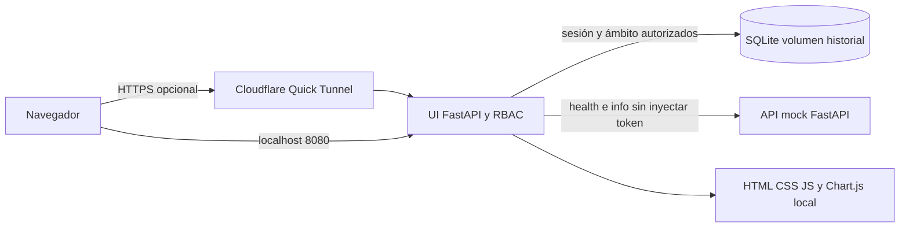

# Arquitectura y autorización del prototipo

## Servicios

La API mock sigue con `/health` público y `/info` Bearer. No se mezcló la sesión UI con el token API. La UI contiene rutas propias `/ui/*` para cuentas, eventos y métricas. Un servicio UI, un archivo SQLite, una instancia Uvicorn; no se agregaron servicios de IA ni nube de pago.

## Matriz de permisos iniciales

| Capacidad | Herrero | Pulidor | Jefe | Admin técnico |
|---|---|---|---|---|
| Leer eventos propios | Sí | Sí | Sí | Sí |
| Leer todos los PC08 | No | No | Sí | No |
| Simular y exportar ámbito autorizado | Sí | Sí | Sí | Sí |
| Estadísticas PC08 propias | Sí | Sí | Incluidas en global | No |
| Estadísticas PC08 globales | No | No | Sí | No |
| Revisar eventos PC08 | No | No | Sí | No |
| Crear/desactivar/restablecer cuentas | No | No | No | Sí |
| Configurar roles, demo, auditoría | No | No | No | Sí |

`read_own`, `read_pc08`, `simulate`, `export`, `stats_own`, `stats_pc08`, `review`, `users`, `roles`, `audit`, `settings` se almacenan como JSON en `roles.permissions`. Modificar un rol es una decisión explícita del administrador y queda auditada; los permisos se releen en cada solicitud. Se mantienen cuatro identificadores estables y nombres/permisos editables, no una taxonomía industrial inventada. Se protege la última cuenta administradora activa y sus permisos de recuperación.

Sin sesión: 401. Con sesión pero sin capacidad/ámbito: 403. Filtros inválidos: 422. La API y las exportaciones aplican la misma restricción de propietario. PC10/12 siempre tienen ámbito propio; sus registros antiguos sin propietario quedan conservados en SQLite y marcados heredados, sin adjudicarlos arbitrariamente. PC08 antiguo sin propietario es visible para el jefe y se excluye de comparaciones por usuario.

## Esquema SQLite versión 2

| Tabla | Campos principales | Relación y propósito |
|---|---|---|
| roles | id PK, name, permissions JSON | Configuración provisional |
| users | id PK, username UNIQUE sin distinción de mayúsculas, display_name, password_hash, role FK, active, created_at | Cuenta con hash Argon2id |
| events | id PK, station, defect, verdict, confidence, stamp, owner_id FK nullable, image_id, origin, review_status, legacy | Conserva identificador y datos previos; origen SIMULADO |
| sessions | token_hash PK, user_id FK, expires | SHA-256 de token aleatorio; duración 8 h |
| audit | id PK, user_id, action, stamp, target | Acciones sin contraseñas ni tokens |
| settings | key PK, value | demo_enabled |
| schema_version | version PK, applied_at | Migración idempotente |

`store.migrate()` añade columnas sin recrear ni truncar `events`. Realiza respaldo SQLite antes de la migración antigua y conserva IDs. Índice `(station, owner_id, stamp)`, claves foráneas activas y timeout de escritura 20 s. No se crean inspecciones al iniciar. El fixture de 18 eventos es una herramienta explícita para pruebas en otra base.

## Estadísticas

Total = cantidad de filas autorizadas y filtradas; OK y defectos por veredicto; rechazo simulado = 100 × defectos / total, redondeado a 1 decimal, nulo si no hay filas. Pendientes = review_status pending. Agrupaciones por defecto, día de El Salvador y propietario asignado. PC10/12 no entran en estas métricas. La comparación por propietario se muestra al jefe únicamente con al menos dos usuarios con registros en la selección; no mide productividad ni prueba asociación industrial correcta.

El dashboard muestra pastel, barras, líneas, comparación por jornada y tabla de frecuencias. El operativo reduce la vista a sus métricas y dos gráficos; el administrativo usa formularios y auditoría. La revisión humana confirma/descarta un evento del demo, no aprueba un machete real. La asociación de eventos nuevos es al usuario autenticado; el backend permite al jefe asignar PC08 a una cuenta activa. No hay asignación por defecto industrial.

## Propuesta industrial vigente tras la visita

La arquitectura de software anterior permanece implementada. La propuesta industrial actual está en el informe final pp. 6–8 y diagramas/arquitectura-posvisita.svg: captura previa entre Pulido y PC08, banco detenido de dos cámaras, perfiles y superficie, PatchCore + OpenCV, revisión humana y distribución futura a 6–8 puestos. Los diagramas flujo-propuesto.svg y soporte-conceptual.svg anteriores son históricos y quedan sustituidos conceptualmente por los archivos posvisita. No hay cámara ni banda conectada al demo.
