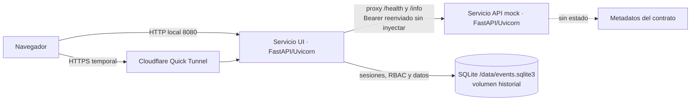

# Anexo técnico · Backend, API y despliegue

**Proyecto:** IMACASA · Módulo PC08 Enderezado · Pimientero G2 (Equipo 01, provisional)
**Rol individual documentado:** Alfredo · Integrante 2 — Backend, API y Despliegue
**Componentes bajo responsabilidad:** `app/api.py`, `app/ui.py`, `app/rbac.py`, `app/store.py`, `app/manage.py`, `compose.yaml`, `Dockerfile`, `preparar.ps1`, `verificar.py`
**Naturaleza:** prototipo académico funcional. No hay cámara, banda ni modelo de IA conectados; los eventos, imágenes y confidencias son simulados. El despliegue descrito es una demostración de una sola instancia, no una plataforma industrial certificada.

---

## 1. Arquitectura del backend y flujo de datos

### 1.1 Vista de componentes



La solución se compone de **dos servicios FastAPI independientes** construidos desde la misma imagen:

| Servicio | Aplicación | Puerto interno | Publicación local | Persistencia |
|---|---|---|---|---|
| `api` | `app.api:app` | 8000 | `127.0.0.1:8000` | Ninguna (sin estado) |
| `ui` | `app.ui:app` | 8000 | `127.0.0.1:8080` | Volumen `historial` en `/data` |

La separación es deliberada: la **API mock** conserva exactamente dos rutas (`/health`, `/info`) y no expone documentación automática; la **UI** contiene el backend propio de la aplicación (`/ui/*`), la autenticación por sesión, el RBAC y el acceso a SQLite. El túnel público apunta al servicio `ui`, que reenvía `/health` y `/info` al servicio `api` conservando la cabecera `Authorization` recibida y **sin inyectar un token válido en nombre del visitante**. Si la API no responde, la UI devuelve `502`.

> Nota de honestidad técnica para el informe: el origen público incluye la interfaz y sus rutas `/ui/*`; los dos endpoints obligatorios están disponibles a través del proxy y cumplen el contrato 200/401/200. No se oculta que la UI tiene backend propio.

### 1.2 Flujo de una petición

1. El navegador solicita la interfaz a `http://localhost:8080` o a la URL HTTPS temporal.
2. El servicio `ui` valida la petición, aplica cabeceras de seguridad y, para rutas `/ui/*`, comprueba la cookie de sesión, el permiso y el ámbito autorizado.
3. Para `/health` y `/info`, el servicio `ui` actúa como proxy hacia `http://api:8000` (nombre de servicio interno de Docker Compose).
4. La API mock compara el Bearer con `API_TOKEN` en tiempo constante y responde `200` o `401`.
5. Las operaciones propias de la aplicación escriben en `/data/events.sqlite3`, respaldado por el volumen nombrado `historial`.
6. Cada acción sensible se registra en la tabla `audit` sin almacenar contraseñas ni tokens.

### 1.3 Persistencia y migración

- Motor: **SQLite** en modo archivo único, con `PRAGMA foreign_keys=ON` y `busy_timeout=20000` (20 s).
- Ruta en contenedor: `/data/events.sqlite3` (`DB_PATH`), montada desde el volumen `historial`.
- `store.migrate()` es **idempotente**: crea tablas y columnas faltantes sin recrear ni truncar `events`, conserva los identificadores existentes y crea un respaldo previo cuando detecta el esquema antiguo.
- Índice de consulta: `(station, owner_id, stamp)`.
- No se siembran inspecciones al iniciar. Los datos de demostración se generan explícitamente desde la UI o mediante un fixture aislado.

**Esquema lógico (versión 2):**

| Tabla | Campos principales | Propósito |
|---|---|---|
| `roles` | `id`, `name`, `permissions` (JSON) | Permisos configurables por rol |
| `users` | `id`, `username` único sin distinción de mayúsculas, `display_name`, `password_hash`, `role`, `active`, `created_at` | Cuentas con hash Argon2id |
| `events` | `id`, `station`, `defect`, `verdict`, `confidence`, `stamp`, `owner_id`, `image_id`, `origin`, `review_status`, `legacy` | Registros sintéticos PC08/PC10/PC12 |
| `sessions` | `token_hash` (SHA-256), `user_id`, `expires` | Sesiones de 8 horas |
| `audit` | `id`, `user_id`, `action`, `stamp`, `target` | Trazabilidad de acciones |
| `settings` | `key`, `value` | Parámetro `demo_enabled` |
| `schema_version` | `version`, `applied_at` | Control de migración |

### 1.4 Configuración

| Variable | Servicio | Uso |
|---|---|---|
| `API_TOKEN` | `api`, `ui` | Bearer del endpoint `/info`; obligatorio al arrancar |
| `UI_USER` / `UI_PASSWORD` | `ui` | Compatibilidad heredada; solo se importa una cuenta si `users` está vacía |
| `DB_PATH` | `ui` | Ruta de SQLite; en Docker `/data/events.sqlite3` |
| `API_URL` | `ui` | Destino del proxy; en Docker `http://api:8000` |

`preparar.ps1` genera `API_TOKEN` con 20 bytes aleatorios (40 caracteres hexadecimales) y **no sobrescribe** un `.env` existente. El token de la API y la contraseña de la interfaz son secretos distintos. `.env` está excluido del build y del repositorio.

---

## 2. Esquema de seguridad y control de acceso

### 2.1 Contraseñas con Argon2id

- Implementación: `argon2-cffi`, `PasswordHasher(type=Type.ID)` (Argon2id) con parámetros de la biblioteca.
- Las contraseñas **nunca** se almacenan en texto plano ni se registran en logs, auditoría o argumentos de línea de comandos.
- La entrada se solicita de forma oculta con `getpass` (CLI) o por HTTPS en administración; longitud admitida: 12 a 200 caracteres.
- En cada inicio de sesión correcto se comprueba `check_needs_rehash`; si procede, el hash se actualiza de forma transparente.
- La verificación captura `VerificationError` e `InvalidHashError` y devuelve un resultado negativo uniforme.

### 2.2 Sesiones de la interfaz

- Token aleatorio de 256 bits aproximadamente (`secrets.token_urlsafe(32)`).
- En SQLite solo se guarda su **hash SHA-256**, nunca el token original.
- Duración: 8 horas; las sesiones vencidas se eliminan al iniciar sesión.
- Cookie `HttpOnly`, `SameSite=Strict` y `Secure` cuando la petición llega por HTTPS.
- Los cambios de contraseña, rol o estado activo revocan las sesiones del usuario afectado.
- El Bearer de `/info` y la cookie de sesión de la UI son mecanismos **independientes**: la cookie no sirve para `/info` y el token de API no autentica la interfaz.

### 2.3 RBAC: cuatro roles

Los identificadores de rol son estables; los nombres y permisos son editables por el administrador y quedan auditados. Los permisos se releen en cada solicitud.

| Capacidad / permiso | Herrero | Pulidor | Jefe | Administrador |
|---|---|---|---|---|
| Leer eventos propios (`read_own`) | Sí | Sí | Sí | Sí |
| Leer todos los PC08 (`read_pc08`) | No | No | Sí | No |
| Simular (`simulate`) | Sí | Sí | Sí | Sí |
| Exportar ámbito autorizado (`export`) | Sí | Sí | Sí | Sí |
| Estadísticas propias (`stats_own`) | Sí | Sí | Incluidas en global | No por defecto |
| Estadísticas PC08 globales (`stats_pc08`) | No | No | Sí | No |
| Revisar eventos PC08 (`review`) | No | No | Sí | No |
| Gestionar cuentas (`users`) | No | No | No | Sí |
| Configurar roles (`roles`) | No | No | No | Sí |
| Consultar auditoría (`audit`) | No | No | No | Sí |
| Parámetros del demo (`settings`) | No | No | No | Sí |

**Ámbito de datos:** el filtro de propietario se aplica en SQL, no solo en la interfaz. El Jefe puede consultar todo PC08; Herrero y Pulidor solo sus propios registros. PC10 y PC12 conservan ámbito propio y no entran en el agregado PC08. Los registros antiguos sin propietario se conservan y se marcan como heredados; no se adjudican a trabajadores inventados.

**Códigos de estado:**

- `401`: sin sesión válida o credenciales incorrectas.
- `403`: sesión válida sin permiso o fuera de ámbito.
- `422`: datos o filtros inválidos.
- `409`: conflicto, por ejemplo intentar dejar el sistema sin administrador activo.

Se protege la **última cuenta administradora activa** y no se permite retirarle los permisos de recuperación (`users`, `roles`, `audit`, `settings`).

### 2.4 Controles adicionales

- **Mutaciones de UI:** exigen `X-Demo-Request: 1` y, cuando existe, verifican que `Origin` coincide con el host. Es una mitigación de demostración, no un esquema CSRF industrial completo.
- **Rate limit:** 10 intentos fallidos por minuto y por IP, en memoria; alcance de demo monoproceso. Detrás de un proxy puede agrupar visitantes y no sustituye protección perimetral.
- **Cabeceras de seguridad:** `Cache-Control: no-store`, `X-Content-Type-Options: nosniff`, `X-Frame-Options: DENY`, `Referrer-Policy: same-origin` y CSP local.
- **Exportación CSV:** se neutralizan celdas que comienzan con `=`, `+`, `-`, `@`, tabulación o retorno de carro para reducir inyección de fórmulas.
- **Auditoría:** registra inicio/cierre de sesión, creación de usuarios, cambios de rol/estado, restablecimientos, revisión de eventos y cambios de parámetros.
- **Respuestas de administración:** nunca devuelven `password_hash`.
- **Secretos:** `.env`, bases, WAL/SHM, respaldos, cookies y capturas de variables no se versionan ni se publican.

### 2.5 Límites declarados

SQLite, el rate limit en memoria y el Bearer compartido son decisiones razonables para un demo académico de una instancia. No constituyen alta disponibilidad, certificación industrial ni resistencia a abuso distribuido.

---

## 3. Especificación de los endpoints obligatorios

### 3.1 `GET /health`

| Atributo | Valor |
|---|---|
| Autenticación | Pública (ninguna) |
| Éxito | `200 OK` |
| Cuerpo | `{"status":"ok"}` |
| Uso | Verificación de disponibilidad y healthcheck de Docker |

El healthcheck de Compose consulta este endpoint cada 10 s, con timeout de 3 s y 5 reintentos; el servicio `ui` espera a que `api` esté `healthy`.

### 3.2 `GET /info`

| Atributo | Valor |
|---|---|
| Autenticación | `Authorization: Bearer <API_TOKEN>` |
| Sin credenciales | `401 Unauthorized` + `WWW-Authenticate: Bearer` |
| Token incorrecto o esquema distinto | `401 Unauthorized` |
| Token válido | `200 OK` con metadatos del equipo, estación, versión y timestamp |
| Comparación | Tiempo constante (`secrets.compare_digest`) |

**Contrato de respuesta exitosa (`200`):**

```json
{
  "equipo": "Pimientero G2 — Equipo 01 (provisional)",
  "estacion": "PC08",
  "version": "1.0.0",
  "timestamp": "2026-11-11T21:35:29.379270+00:00"
}
```

- `equipo`: identificación provisional; no debe presentarse como número oficial confirmado.
- `estacion`: siempre `PC08`.
- `version`: versión del contrato mock (`1.0.0`), no la versión del frontend.
- `timestamp`: ISO 8601 en UTC con zona horaria explícita.

**Respuesta sin credenciales (`401`):**

```json
{"detail": "Credenciales ausentes o incorrectas"}
```

Si `API_TOKEN` no está definido, la aplicación **falla al arrancar** (`RuntimeError`): no se inicia un servicio con autenticación deshabilitada.

### 3.3 Proxy de la UI

El servicio `ui` expone `/health` y `/info` como proxy. Reenvía la cabecera `Authorization` tal como llega, incluida su ausencia. Esto permite validar el contrato desde la URL pública sin revelar el token a la interfaz. Si la API interna no está disponible, responde `502 {"detail":"API no disponible"}`.

### 3.4 Criterios de aceptación

| Prueba | Resultado exigido |
|---|---|
| `GET /health` | `200` y cuerpo exacto `{"status":"ok"}` |
| `GET /info` sin cabecera | `401` con `WWW-Authenticate: Bearer` |
| `GET /info` con token incorrecto | `401` |
| `GET /info` con `Basic` en lugar de `Bearer` | `401` |
| `GET /info` con token válido | `200`; claves `equipo`, `estacion`, `version`, `timestamp`; `estacion == "PC08"`; timestamp con zona |
| `GET /docs` | `404` (documentación automática deshabilitada) |

`verificar.py` automatiza exactamente estas comprobaciones y **nunca imprime el token**.

---

## 4. Contenedorización y túnel público

### 4.1 Imagen Docker

`Dockerfile` usa `python:3.12-slim` y etapas `base`, `test` y `runtime`:

- Instala `requirements.txt` con `--no-cache-dir` (FastAPI, Uvicorn, httpx, argon2-cffi).
- Copia solo `app/`.
- Crea un usuario **no root** (`demo`) y prepara `/data` con su propiedad.
- Expone el puerto 8000.
- Comando por defecto: `uvicorn app.api:app --host 0.0.0.0 --port 8000`; el servicio `ui` lo sobrescribe con `app.ui:app`.
- La etapa `test` instala `requirements-dev.txt`, copia `tests/` y ejecuta `pytest`.
- `.dockerignore` excluye `.env`, bases SQLite, WAL/SHM, respaldos, `docs`, `private`, PDF/DOCX y logs.

### 4.2 Docker Compose

| Servicio | Función | Publicación | Dependencias | Reinicio |
|---|---|---|---|---|
| `api` | API mock de dos rutas | `127.0.0.1:8000` | — | `unless-stopped` |
| `ui` | Interfaz, RBAC y SQLite | `127.0.0.1:8080` | `api` saludable | `unless-stopped` |
| `tunnel` | Cloudflare Quick Tunnel | — | `ui` | `no` (perfil `publico`) |

- `api` y `ui` se enlazan a `127.0.0.1`: no quedan expuestos directamente a la red local.
- El volumen nombrado `historial` monta `/data` en `ui`; **no usar `docker compose down -v`** porque elimina el historial.
- `restart: unless-stopped` mantiene los servicios tras reinicios del equipo, salvo parada explícita.
- El túnel solo se inicia con `--profile publico` y tiene `restart: "no"` porque la URL es efímera.

### 4.3 Cloudflare Quick Tunnel

```yaml
tunnel:
  image: cloudflare/cloudflared:latest
  command: ["tunnel", "--no-autoupdate", "--url", "http://ui:8000"]
  profiles: ["publico"]
```

Características:

- Emite una URL HTTPS temporal `https://<aleatorio>.trycloudflare.com` sin cuenta ni dominio propio.
- No hay garantía de disponibilidad, permanencia ni rendimiento; la URL cambia en cada arranque.
- La URL debe comunicarse **solo después de verificarla** y no debe presentarse como enlace permanente.
- El tráfico termina en `ui`; desde allí se prueba el contrato completo.
- Al finalizar la clase: `docker compose stop tunnel`.

### 4.4 Riesgos y mitigaciones

| Riesgo | Mitigación |
|---|---|
| URL temporal inestable | Verificar en clase y tener un plan de reinicio documentado |
| Token expuesto en capturas/chat | No imprimirlo; usar `verificar.py`; rotar si se filtra |
| Pérdida de datos | Volumen `historial`; nunca `down -v`; respaldo con la API SQLite |
| Acceso externo no deseado | Túnel detenido fuera de clase; puertos solo en loopback |
| Reinicio del equipo en clase | Docker Desktop iniciado y `restart: unless-stopped`; comprobar antes |
| SQLite bajo concurrencia | `busy_timeout`, una instancia; no es un motor de alta concurrencia |

---

## 5. Guía operativa y checklist individual

> Ejecutar en **Windows PowerShell**, desde la carpeta que contiene `compose.yaml`, con **Docker Desktop iniciado**. No abrir `app/static/index.html` como archivo suelto.

### Paso 0 · Verificaciones previas

```powershell
docker version
docker compose version
python --version
Test-Path .\compose.yaml
```

Requisitos: Docker Desktop operativo, Python 3.12 o 3.13 local (solo para `preparar.ps1`/`verificar.py`), Git y acceso al repositorio.

### Paso 1 · Aprovisionamiento inicial

```powershell
.\preparar.ps1
```

Resultado esperado: se crea `.env` con `API_TOKEN` aleatorio, `UI_USER=pimientero` y `UI_PASSWORD=`. Si `.env` ya existe, el script lo conserva y no rota credenciales. **No compartir ni capturar `.env`.**

Comprobar sin imprimir el secreto:

```powershell
$line = Get-Content -LiteralPath .env | Where-Object { $_ -match '^API_TOKEN=' } | Select-Object -First 1
($line -split '=',2)[1].Length   # Debe ser 40
```

### Paso 2 · Construcción y arranque

```powershell
docker compose up -d --build
docker compose ps
```

Esperado: `api` y `ui` en estado `running`; `api` debe aparecer `healthy`. Si `api` falla con el mensaje de `API_TOKEN`, faltó ejecutar `preparar.ps1`. Si el puerto está ocupado, detener la instancia previa (Docker o `iniciar_local.py`).

### Paso 3 · Crear la cuenta administradora inicial

```powershell
docker compose exec ui python -m app.manage create-user --username admin-local --name "Administrador del demo" --role admin
```

- La terminal pedirá la contraseña **dos veces**; al escribir no se muestran caracteres.
- Longitud: 12 a 200 caracteres. Usar una contraseña distinta de `API_TOKEN`.
- **No** añadir `-T` ni pasar la contraseña como argumento.
- Se ejecuta dentro del servicio `ui` para escribir en el volumen `/data`; ejecutarlo en el host crearía otra base (`events.sqlite3`) fuera del contenedor.

Cuentas opcionales para la demostración de roles:

```powershell
docker compose exec ui python -m app.manage create-user --username supervisor-demo --name "Jefe de demostración" --role supervisor
docker compose exec ui python -m app.manage create-user --username herrero-demo --name "Herrero de demostración" --role herrero
docker compose exec ui python -m app.manage create-user --username pulidor-demo --name "Pulidor de demostración" --role pulidor
```

Si una cuenta ya existe, el comando no la reemplaza. Para cambiar una clave: `docker compose exec ui python -m app.manage reset-password --username NOMBRE` (revoca sus sesiones).

### Paso 4 · Validación local obligatoria

```powershell
python verificar.py http://localhost:8080
```

Salida esperada al final:

```text
APROBADO: health 200, info sin token 401, token incorrecto 401, token válido 200.
```

El script lee `API_TOKEN` del entorno o de `.env`, usa solo la biblioteca estándar y no imprime el token. Si falta Python local, se puede validar con `curl.exe` (Paso 5B) o instalar Python 3.12/3.13; no se requiere `pip install`.

### Paso 5A · Túnel público temporal y verificación con `verificar.py`

```powershell
docker compose --profile publico up -d tunnel
docker compose logs --tail 40 tunnel
```

Localizar en el log la URL recién emitida, por ejemplo `https://algo-aleatorio.trycloudflare.com`. Usar **esa** URL, no una histórica.

```powershell
python verificar.py https://algo-aleatorio.trycloudflare.com
```

### Paso 5B · Verificación con `curl` exigida en la rúbrica

En PowerShell, usar `curl.exe` (el alias `curl` apunta a `Invoke-WebRequest` y no acepta las mismas opciones).

```powershell
# 1) Salud pública: debe devolver HTTP 200 y {"status":"ok"}
curl.exe -sS -i https://algo-aleatorio.trycloudflare.com/health

# 2) Info sin credenciales: debe devolver HTTP 401
curl.exe -sS -i https://algo-aleatorio.trycloudflare.com/info

# 3) Cargar el token en la sesión SIN imprimirlo
$line = Get-Content -LiteralPath .env | Where-Object { $_ -match '^API_TOKEN=' } | Select-Object -First 1
$env:API_TOKEN = ($line -split '=',2)[1]
if ($env:API_TOKEN.Length -ne 40) { throw 'Token inesperado en .env' }

# 4) Info con token válido: debe devolver HTTP 200 y los cuatro metadatos
curl.exe -sS -i -H "Authorization: Bearer $env:API_TOKEN" https://algo-aleatorio.trycloudflare.com/info

# 5) Token incorrecto: debe devolver HTTP 401
curl.exe -sS -i -H "Authorization: Bearer token-invalido" https://algo-aleatorio.trycloudflare.com/info

# 6) Limpiar la variable de la sesión
Remove-Item Env:API_TOKEN
```

Resultado exigido: `200 / 401 / 200 / 401`, con `WWW-Authenticate: Bearer` en los `401` y `estacion: "PC08"` en el `200`.

Si no se dispone de `curl.exe`, alternativa nativa:

```powershell
Invoke-RestMethod -Uri https://algo-aleatorio.trycloudflare.com/health
Invoke-WebRequest -Uri https://algo-aleatorio.trycloudflare.com/info -SkipHttpErrorCheck
Invoke-RestMethod -Uri https://algo-aleatorio.trycloudflare.com/info -Headers @{ Authorization = "Bearer $env:API_TOKEN" }
```

### Paso 6 · Cierre y conservación de datos

```powershell
docker compose stop tunnel      # cerrar acceso externo
docker compose stop             # detener api y ui conservando el volumen
docker compose up -d            # volver a iniciar sin reconstruir
```

- Nunca ejecutar `docker compose down -v`: borra el volumen `historial`.
- Para diagnóstico: `docker compose logs --tail 50 api ui`.
- Respaldo coherente de SQLite: ver `docs/SEGURIDAD.md`.
- Rotación del token si se expuso: ver `docs/SEGURIDAD.md`; recrear `api` y `ui` y repetir `verificar.py`.

### Checklist previo a la clase

- [ ] Docker Desktop iniciado y estable.
- [ ] `.env` presente; `API_TOKEN` con 40 caracteres; secreto no mostrado.
- [ ] `docker compose ps` muestra `api` como `healthy`.
- [ ] `python verificar.py http://localhost:8080` termina en `APROBADO`.
- [ ] Inicio de sesión con `admin-local` comprobado en `http://localhost:8080`.
- [ ] Túnel recién levantado y URL nueva verificada con `verificar.py`.
- [ ] Pruebas `curl.exe`: `/health` 200, `/info` 401, `/info` con Bearer 200, `/info` con token inválido 401.
- [ ] Prueba adicional desde el teléfono por HTTPS.
- [ ] Equipo conectado a corriente y sin suspensión; terminal del túnel abierta.
- [ ] Plan de contingencia: reiniciar túnel y volver a verificar si cambia la URL.
- [ ] Capturas/evidencias sanitizadas, sin token ni `.env`.

---

## 6. Trazabilidad con la rúbrica

| Requisito | Evidencia en el repositorio | Estado |
|---|---|---|
| API mock de dos rutas | `app/api.py`, `tests/test_app.py` | Implementado y probado |
| `/health` público 200 | `app/api.py`, `verificar.py`, `cloudflare-verificacion.json` | Verificado |
| `/info` 401 sin token / 200 con Bearer | `app/api.py`, `verificar.py`, pruebas y evidencias | Verificado |
| Dockerfile y Compose | `Dockerfile`, `compose.yaml` | Implementado |
| Volumen persistente | `historial:/data`, `docs/PRUEBAS.md` | Verificado con 38 eventos conservados |
| Túnel Cloudflare temporal | `compose.yaml` (perfil `publico`), `docs/DESPLIEGUE.md` | Verificado; URL debe revalidarse en clase |
| RBAC de cuatro roles | `app/rbac.py`, `app/store.py`, `tests/test_rbac.py` | Verificado |
| Argon2id | `app/store.py`, `tests/test_rbac.py` | Verificado |
| Guía operativa | este anexo, `README.md`, `docs/DESPLIEGUE.md`, `docs/CUENTAS.md` | Documentado |

**Ejecución local del 11/11/2026 (sin Docker):** 9/9 pruebas Python aprobadas y contrato `200/401/401/200` verificado con `verificar.py`; evidencia en `docs/evidencias/verificacion-local-2026-11-11.json`. La construcción con Docker, el túnel y la prueba desde teléfono quedan pendientes en el equipo de presentación.

La rúbrica oficial no se autocalifica: esta tabla traza cobertura, no asigna puntaje. La disponibilidad del túnel durante la clase y la prueba física desde un teléfono deben confirmarse en el momento.

---

## 7. Declaración de aporte individual (texto sugerido para el informe)

> En mi rol de responsable de Backend, API y Despliegue, implementé y verifiqué la separación entre la API mock de dos endpoints y el backend de la interfaz; el control de acceso basado en roles con cuatro perfiles y ámbito aplicado en SQL; el almacenamiento de contraseñas con Argon2id y de sesiones mediante hash SHA-256; la migración idempotente de SQLite con volumen persistente; la contenedorización no root con Docker Compose; y la exposición temporal mediante Cloudflare Quick Tunnel. Validé el contrato exigido con `verificar.py` y peticiones `curl`, documentando tanto los resultados como los límites del prototipo: datos simulados, una sola instancia y una URL temporal sin garantía de disponibilidad.

---

## 8. Referencias internas

- `docs/ARQUITECTURA.md` — servicios, esquema y matriz de permisos.
- `docs/API.md` — contratos de API y UI.
- `docs/SEGURIDAD.md` — credenciales, respaldo y rotación.
- `docs/DESPLIEGUE.md` — arranque local y túnel.
- `docs/CUENTAS.md` — creación de las cuatro cuentas.
- `docs/PRUEBAS.md` — pruebas y resultados verificables.
- `docs/evidencias/cloudflare-verificacion.json` y `cloudflare-posvisita.json` — evidencia HTTPS.
